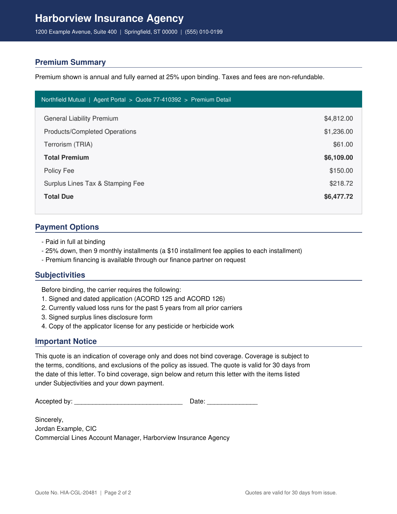

When you [extract document data with Sensible](doc:getting-started-ai), Sensible automatically OCRs the document for you, except in advanced cases. This topic covers advanced cases. 

 For information about additional OCR options, see [OCR](doc:ocr).

Use the OCR preprocessor to selectively OCR pages in a document. This preprocessor is useful when a document contains both embedded text and text images. Selectively OCRing the pages containing text images, rather than the entire document, improves extraction performance. Examples of text images include handwriting and scanned text.

You can also use this preprocessor to force OCR for a whole document if it's missing expected embedded text, for example when the expected text is a text image, but the document contains enough embedded text that Sensible doesn't [OCR the whole document by default](doc:ocr-level).

If the whole document is a scan or image file, you don't need to configure this preprocessor. In that case, Sensible OCRs the whole document by default.

# Parameters

| key                                                                | value                                            | description                                                                                                                                                                                                                                                                                                                                                                                                                                                                                                                                |
| ------------------------------------------------------------------ | ------------------------------------------------ | ------------------------------------------------------------------------------------------------------------------------------------------------------------------------------------------------------------------------------------------------------------------------------------------------------------------------------------------------------------------------------------------------------------------------------------------------------------------------------------------------------------------------------------------ |
| type (**required**)                                                | `ocr`                                            |                                                                                                                                                                                                                                                                                                                                                                                                                                                                                                                                            |
| match (**required** unless you specify the Page Lines Limit or OCR If Missing parameter) | Match object or  [Match array](doc:match-arrays) | If specified, Sensible runs this preprocessor solely on the page containing the matched text. If there are multiple text matches in the document, matches the first.<br/> <br/>To match multiple pages, set the Match All parameter to true.                                                                                                                                                                                                                                                                                               |
| matchAll                                                           | boolean                                          | If true, OCRs all pages containing the line specified by the Match parameter.                                                                                                                                                                                                                                                                                                                                                                                                                                                              |
| pageLinesLimit                                                     | integer                                          | Performs OCR on all pages containing the specified number of embedded text lines or fewer. Use this parameter to OCR pages for which no reliable text anchors exist. Sensible recommends specifying a small number relative to the typical number of page lines in the document type, since pages with a small number of embedded lines more likely contain text images.<br/> If you specify this in combination with a Match parameter, Sensible OCR all pages that meets any of the match criteria or the number of page lines criteria. |
| pageOffset                                                         | number. default: 0                               | The zero-indexed number of the page to OCR, counting from the page number of the text matched by the Match parameter. For example, if you know that the page after the heading "Policy Addendums" is always a scanned image, then you specify:  `"type": "ocr", "match": "policy addendums", "pageOffset": 1`.<br/>       To OCR a single page offset from the first page of the document, specify the first page using the syntax `"match": { "type": "first" }`.                                                                         |
| ocrIfMissing                                                       | Match object or  [Match array](doc:match-arrays) | If Sensible doesn't find the matched text in the document, it OCRs every page. If it finds the text, it OCRs nothing. Use this parameter for documents with enough embedded text that Sensible doesn't [OCR them by default](doc:ocr-level), even when they contain text images such as a pasted screenshot. Choose text that's in every document of this type, but that can variably need OCR.<br/><br/>If you specify an empty array, Sensible OCRs nothing. You can combine this parameter only with the Engine parameter.<br/><br/>For an example, see [OCR when expected text is missing](doc:ocr-preprocessor#ocr-when-expected-text-is-missing). |
| engine                                                             |                                                  | See [OCR engine](doc:ocr-engine).                                                                                                                                                                                                                                                                                                                                                                                                                                                                                                          |

# Examples

## OCR selected pages

To OCR only the pages that contain text images, select them by text match or page position. The following config OCRs specific pages, and then outputs all lines of the document (`"id": "all_lines_in_doc"`), to double check that OCR extracted the text on those pages. 

```json
/* Sensible uses JSON5 to support in-line comments*/
{
  "preprocessors": [
    {
      /* OCR first page of document */
      "type": "ocr",
      "match": { "type": "first" },
    },
    {
      /* OCR fourth page of document */
      "type": "ocr",
      "match": { "type": "first" },
      "pageOffset": 3
    },
    {
      /* OCR all pages containing text 'additional riders'  */
      "type": "ocr",
      "match": "additional riders",
      "matchAll": true,
    },  
      
  ],
  "fields": [
     
    {
      /* check OCR output */
      "id": "all_lines_in_doc",
      "method": {
        "id": "documentRange",
        "includeAnchor": true
      },
      "anchor": {
        "match": {
          "type":"first"
        }
      }
    }
  ],
}
```

## OCR when expected text is missing

The following example shows how to OCR an insurance quote only when its premium table isn't readable as embedded text. In this example scenario, the premium table is sometimes digitally embedded text, and sometimes it's a screenshot from the carrier's portal. In the example document, the table is a screenshot, so the premium amounts aren't in its embedded text. Because the rest of the quote is embedded text, Sensible doesn't OCR the document by default. The config checks the embedded text for "Total Premium". If Sensible doesn't find it, it OCRs every page, and then extracts the premiums from the screenshot. If Sensible finds it, it skips OCR, so you don't pay to OCR quotes that don't need it.

**Config**

```json
{
  "preprocessors": [
    {
      "type": "ocr",
      /* if "Total Premium" isn't in the embedded text, OCR every page.
         if it is, skip OCR */
      "ocrIfMissing": {
        "type": "includes", /* match anywhere in line. */
        "text": "Total Premium" /* string to match */
      }
    }
  ],
  "fields": [
    {
      "id": "total_premium", /* user-friendly ID for extracted target data */
      "type": "currency", /* Sensible formats extracted data as this data type, or returns null if it doesn't recognize extracted data as the specified type */
      "anchor": "Total Premium", /* an anchor is text that always occurs in the same position relative to your target data. Without an anchor, Sensible wouldn't know which page to search in for your target data. */
      "method": {
        "id": "row", /* target data to extract is distributed on same horizontal line as anchor */
        "position": "right" /* default: right. target data is to left or right of anchor. enums: left | right. */
      }
    },
    {
      "id": "total_due",
      "type": "currency",
      "anchor": "Total Due",
      "method": {
        "id": "row",
        "position": "right"
      }
    }
  ]
}
```

**Example document**

The following image shows page 2 of the example document. The premium table under the Premium Summary heading is a screenshot from the carrier's portal, so "Total Premium" isn't in the document's embedded text until Sensible OCRs the document.



| Example document | [Download link](https://raw.githubusercontent.com/sensible-hq/sensible-docs/v0/assets/pdfs/ocr_if_missing_quote.pdf) |
| ---------------- | --------------------------------------------------------------------------------------------------------------- |

**Output**

```json
{
  "total_premium": {
    "source": "$6,109.00",
    "value": 6109,
    "unit": "$",
    "type": "currency"
  },
  "total_due": {
    "source": "$6,477.72",
    "value": 6477.72,
    "unit": "$",
    "type": "currency"
  }
}
```
