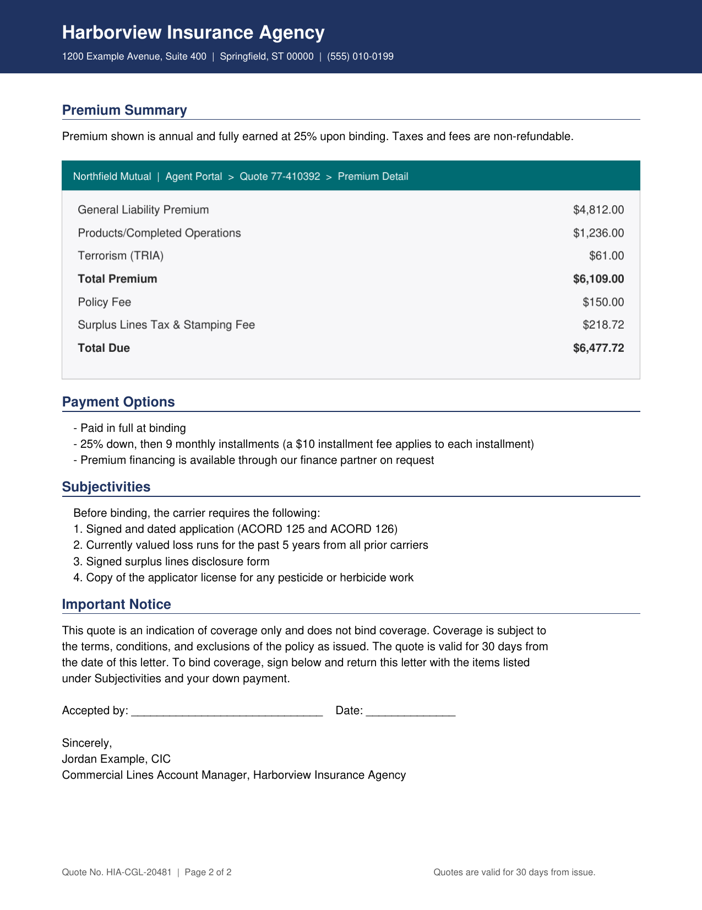

<!-- Draft example for the OCR preprocessor's Omit parameter (sensible-hq/sensible#3519).
     Destination: the Examples section of docs/Senseml reference/preprocessors/ocr-preprocessor.md.
     Proposed rename: omit -> expectMatch. Update the config if the rename lands. -->

## Example: OCR when expected text is missing

The following example shows how to OCR an insurance quote only when its premium table isn't readable as embedded text. Insurance agents often paste a screenshot of the carrier's premium table into an otherwise digital quote, so the premium amounts aren't in the document's embedded text. The config checks for the text "Total Premium". If Sensible doesn't find it, it OCRs every page, and then extracts the premiums from the screenshot. If Sensible finds it, it skips OCR, so you don't pay to OCR quotes that don't need it.

**Config**

```json
/* Sensible uses JSON5 to support in-line comments*/
{
  "preprocessors": [
    {
      "type": "ocr",
      "omit": {
        "type": "includes", /* match anywhere in line. */
        "text": "Total Premium" /* string to match */
      }
    }
  ],
  "fields": [
    {
      "id": "total_premium", /* user-friendly ID for extracted target data */
      "type": "currency", /* Sensible formats extracted data as this data type, or returns null if it doesn't recognize extracted data as the specified type */
      "anchor": "Total Premium", /* an anchor is text that always occurs in the same position relative to your target data. Without an anchor, Sensible wouldn't know which page to search in for your target data. */
      "method": {
        "id": "row", /* target data to extract is distributed on same horizontal line as anchor */
        "position": "right" /* default: right. target data is to left or right of anchor. enums: left | right. */
      }
    },
    {
      "id": "total_due",
      "type": "currency",
      "anchor": "Total Due",
      "method": {
        "id": "row",
        "position": "right"
      }
    }
  ]
}
```

**Example document**

The following image shows page 2 of the example document. The premium table under the Premium Summary heading is a screenshot from the carrier's portal, so "Total Premium" isn't in the document's embedded text until Sensible OCRs the document.



| Example document | [Download link](https://raw.githubusercontent.com/sensible-hq/sensible-docs/v0/assets/pdfs/ocr_omit_quote.pdf) |
| ---------------- | --------------------------------------------------------------------------------------------------------------- |

**Output**

```json
{
  "total_premium": {
    "source": "$6,109.00",
    "value": 6109,
    "unit": "$",
    "type": "currency"
  },
  "total_due": {
    "source": "$6,477.72",
    "value": 6477.72,
    "unit": "$",
    "type": "currency"
  }
}
```
